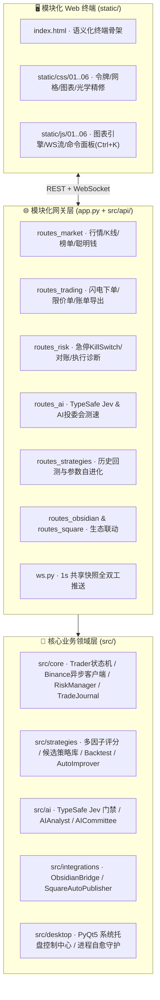

<div align="center">

# ⚡ Aether Quant Studio · 苍穹量枢

**个人量化玩具 · 币安永续合约多策略智能量化终端与策略自进化实验室**

[](https://www.python.org/)
[](https://fastapi.tiangolo.com/)
[](#)
[](#系统架构)
[](./LICENSE)

> **免责声明**：本项目是一个用于探索量化工程架构、多因子技术信号、AI 风控门禁与策略回测自进化的**个人量化玩具（Personal Quant Toy & Sandbox）**。默认以零风险的 **只读预览（`READONLY`）/ 模拟盘（`PAPER`）** 启动，不构成任何投资建议。加密衍生品波动剧烈，请务必对自己的资金安全负责。

</div>

---

## ✨ 核心特性矩阵

### 1. 🛡️ 五级渐进式安全沙盒与双核硬风控
- **五档运行模式无缝切换**：`READONLY`（物理锁定零下单）→ `SHADOW`（影子信号追踪）→ `PAPER`（本地仿真撮合）→ `MICRO_LIVE`（小微仓位实盘试水）→ `LIVE`（标准实盘）。
- **常驻紧急急停（Emergency Kill Switch）**：顶栏一键瞬时切断自动交易、并发撤销挂单并支持市价全平，配合本地状态与交易所实盘仓位实时对账（Reconciliation）与数据陈旧度熔断器。
- **System-One & System-Two 协同门禁**：内置 **TypeSafe Jev (System One)** 毫秒级校准风控门禁与多模型 **AI 投委会（DeepSeek / OpenAI / Claude）** 交叉审查。

### 2. 🖥️ 模块化机构级看盘终端与极客交互（v2.0 UI）
- **TradingView 级交互视窗**：支持多周期切换（`1m` ~ `1w`）、主图叠加（EMA / BOLL / VWAP / 密集成交区 / 趋势高低点 / 开仓止损止盈线）、副图联动（VOL / MACD / RSI）、画线标尺测量与图上点选 GTC 限价开单。
- **`Ctrl + K` 全局极客命令面板**：随时呼出毛玻璃指令中心，支持合约标的毫秒级模糊检索跳转、周期秒切、视图切换与单键快捷操作（`F` 全屏沉浸看盘、`D` 明暗主题秒切、`?` 呼出指令面板）。
- **五套光学主题 + 色弱无障碍支持**：内置 `午夜深蓝 (Midnight)`、`深蓝黑 (Navy)`、`纯黑 OLED`、`石墨灰 (Graphite)` 与 `白色简约 (Minimal Light)` 五套主题，遵循现代 CSS `color-scheme` 标准同步适配原生表单与滚动条，并提供一键 **红绿 / 蓝橙（WCAG 色弱友好）** 切换。

### 3. 🧬 7 大候选策略仿真回测与防过拟合自进化
- 内置趋势跟随、动量突破、均值回归、TTM 挤压、聪明钱资金流、动态网格等策略注册表。
- **70% 样本内网格寻优 + 30% 样本外（OOS）防过拟合检验**：自动对比优化前后净值曲线、夏普比率、最大回撤与胜率，支持一键热加载至运行时预设。

### 4. 📓 Obsidian 双链知识库编译 & ✍️ 币安广场工作室
- **Obsidian 双向桥接**：支持将每日成交复盘、交互式 HTML 买卖点图表、K 线截图标注与**五维交易习惯行为金融学雷达**同步归档至本地 Obsidian Vault，并支持策略规则实时匹配当前盘面。
- **广场图文研报工作台**：结合实时盘口价格防幻觉校验与 16:9 数据封面合成，辅助生成结构化复盘笔记。

---

## 🏗️ 系统架构



---

## 📂 项目目录结构

```text
aether-quant-studio/
├── app.py                          # FastAPI 轻量级应用组装入口
├── config.example.json             # 开源脱敏版默认配置模板（首次运行自动初始化本地 config.json）
├── pyproject.toml                  # Python 项目元数据与 Pytest 测试路径配置
├── requirements.txt                # 依赖包清单
├── start.bat / stop.bat            # Windows 一键启动与安全停止脚本
│
├── src/                            # 高内聚分层后端包
│   ├── paths.py                    # 统一项目路径定位与模块加载引导
│   ├── core/                       # 核心交易引擎 (trader, binance_client, risk_manager, config, trade_journal)
│   ├── strategies/                 # 策略因子、7大候选策略、仿真回测与参数自进化引擎
│   ├── ai/                         # TypeSafe Jev 直觉门禁、AI K线解盘与多模型投委会
│   ├── integrations/               # Obsidian 双链知识库桥接与币安广场发布工作室
│   ├── api/                        # 9 个按领域拆分的 FastAPI 路由与 WebSocket 模块
│   └── desktop/                    # Windows 右下角系统托盘微控面板与后台进程守护器
│
├── static/                         # 零构建模块化现代前端
│   ├── index.html                  # 主终端页面骨架
│   ├── css/                        # 01-base-and-tokens ~ 06-aether-ui-polish 模块化样式表
│   ├── js/                         # 01-core-i18n-theme ~ 06-command-palette 模块化脚本
│   └── icons/                      # 站点与桌面托盘状态图标
│
├── scripts/                        # 离线复盘、历史仿真与桌面端启动器脚本
├── config/strategy_presets.json    # 策略优化参数预设配置
├── tools/binance_square/           # Node.js 广场图文发布辅助脚本
├── docs/                           # 架构演进与特性设计文档
└── tests/                          # 40+ 模块化单元与契约测试套件
```

---

## 🚀 快速开始

### 1. 克隆仓库并安装依赖

```bash
git clone https://github.com/qts2218346424-cyber/aether-quant-studio.git
cd aether-quant-studio
pip install -r requirements.txt
```

### 2. 启动量化终端（开箱即用）

无需预先手动配置 API Key——首次启动时若本地不存在 `config.json`，系统会自动基于 [`config.example.json`](./config.example.json) 生成安全默认配置（默认关闭实盘下单、开启模拟保护模式）：

```bash
python app.py
```

Windows 用户也可直接双击运行根目录下的 `start.bat`（若安装了 `PyQt5` 与 `psutil`，还会同步在任务栏右下角开启系统托盘微控中心）。

启动后在浏览器访问：**http://localhost:8800**

### 3. 终端效率快捷键

| 快捷键 | 功能说明 |
| :--- | :--- |
| `Ctrl + K` / `?` | 呼出全局极客命令面板（模糊搜索合约标的、秒切周期、打开工作台） |
| `F` / `ESC` | 进入 / 退出 K 线全屏沉浸看盘模式 |
| `D` | 一键切换 **深空暗黑** 与 **白色简约** 视觉主题 |

---

## 🧪 运行测试套件

```bash
pytest -q
```

---

## 🔒 密钥与隐私安全设计

- 本地真实凭证文件 `config.json`、运行日志 `logs/`、本地成交记录 `data/` 已在 [`.gitignore`](./.gitignore) 中严格隔离，绝不纳入版本控制。
- Web 端 `/api/config` 接口在读取配置时自动对所有 `api_key` / `api_secret` 实施掩码脱敏，写回配置时采用同目录原子临时文件替换与防掩码覆盖校验，杜绝误操作损坏凭证。

---

## 📄 开源协议

本项目基于 [MIT License](./LICENSE) 开源发布。
