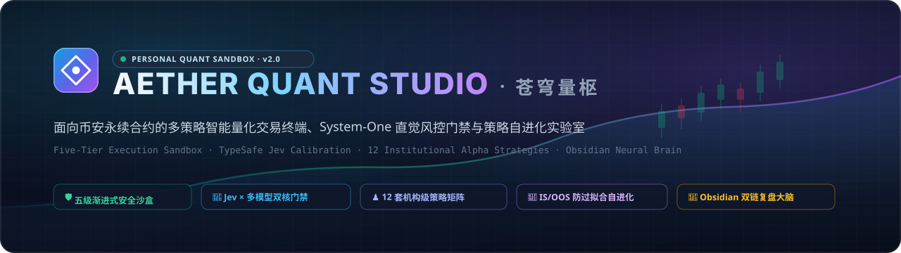
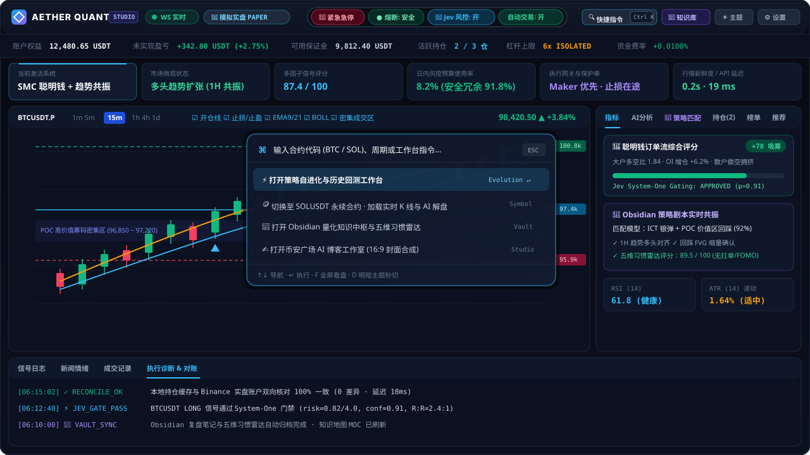
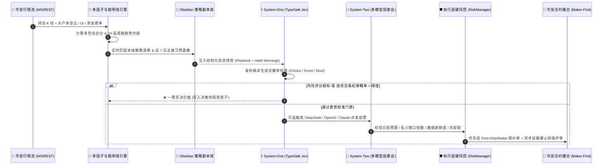
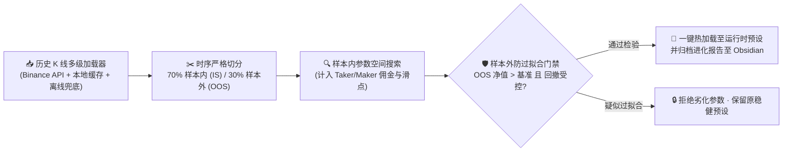

<div align="center">



<br />

[](https://www.python.org/)
[](https://fastapi.tiangolo.com/)
[](#)
[](#-12-套机构级阿尔法策略矩阵)
[](#-卡尼曼快慢双系统协同决策架构)
[](#-obsidian-双链知识大脑与行为金融学雷达)
[](#-自动化测试与质量保障)
[](./LICENSE)

<p align="center">
  <strong>把冰冷的命令行黑盒脚本，进化为可观测、可推演、可自进化的个人量化工程实验室。</strong><br />
  <sub>融合五级实盘安全沙盒 · System-One 直觉概率门禁 · TradingView 级多图层终端 · IS/OOS 防过拟合回测 · Obsidian 行为习惯追踪</sub>
</p>

<p align="center">
  <a href="#-设计哲学为什么构建苍穹量枢">设计哲学</a> ·
  <a href="#️-模块化量化驾驶舱全景">终端全景</a> ·
  <a href="#-卡尼曼快慢双系统协同决策架构">双核决策引擎</a> ·
  <a href="#️-12-套机构级阿尔法策略矩阵">12大策略矩阵</a> ·
  <a href="#️-五级渐进式沙盒与六重硬风控">五级风控沙盒</a> ·
  <a href="#-7030-样本内外防过拟合自进化">策略自进化</a> ·
  <a href="#-快速开始3-分钟开箱即用">快速开始</a> ·
  <a href="#-核心-api-速查字典">API 字典</a>
</p>

</div>

---

> [!IMPORTANT]
> **项目定位与风险提示**：**Aether Quant Studio（苍穹量枢）** 是一款面向个人极客与量化研究者的开源**个人量化玩具与多策略实验平台（Personal Quant Toy & Engineering Sandbox）**。系统出厂默认锁定在零资金风险的 **只读预览（`READONLY`）/ 模拟撮合（`PAPER`）** 模式。本项目仅用于量化软件架构、微观订单流因子与 AI 风控门禁研究，不构成任何投资或交易建议。

---

## 🎯 设计哲学：为什么构建「苍穹量枢」？

大多数个人量化项目往往停留在两个极端：要么是缺乏可视化与风控状态机的**裸奔命令行脚本**，一旦网络抖动或滑点放大便陷入盲盒失控；要么是直接让生成式大模型（LLM）裸调下单接口，被**价格幻觉与高延迟**反噬本金。

**Aether Quant Studio v2.0** 围绕四条核心工程信条重构了个人量化工作流：

| 传统个人量化痛点 | 苍穹量枢（Aether Quant Studio）工程解法 |
| :--- | :--- |
| **黑盒运行、缺乏盘感与现场诊断** | 打造零构建模块化的 **Web 全景看盘驾驶舱 + Windows 系统托盘微控中心**，K 线买卖点、支撑压力、筹码密集区（POC）与毫秒级执行诊断同屏共振。 |
| **大模型直接做交易决策存在幻觉与延迟** | 引入卡尼曼**快慢双系统架构**：先由 **System-One（TypeSafe Jev）** 进行毫秒级非生成式类型化概率校准（`Choice` / `Score` / `Noul`），再联动多模型投委会与执行层硬风控一票否决。 |
| **历史回测曲线完美，一上实盘就回撤** | 内置 **70% 样本内（IS）寻优 + 30% 样本外（OOS）盲测检验** 自进化管线，叠加双边佣金、动态滑点与资金费率真实损耗仿真。 |
| **人性的扛单、频繁追涨杀跌无法量化** | 独创 **Karpathy 范式 Obsidian 双链知识库编译器**，自动将每日交割单转化为「五维行为金融学习惯雷达」，让系统反过来约束交易者的手痒与情绪波动。 |

---

## 🖥️ 模块化量化驾驶舱全景

<div align="center">
  
  <br />
  <sub>▲ Aether Quant Studio v2.0 深空午夜主题（Midnight）与 <code>Ctrl + K</code> 毛玻璃极客命令面板交互示意</sub>
</div>

### 交互与视觉体验工程亮点

1. **双核风控中枢顶栏（Cockpit Header）**
   - 顶栏正中常驻 **`🚨 紧急急停 (Kill Switch)`**、**`● 熔断与实盘对账指示器`**、**`🧠 Jev 风控门禁开关`** 与 **`自动交易主控`**，任何极端行情下 1 次点击即可完成撤单锁仓。
2. **专业级多维图层视窗（ECharts Quantitative Canvas）**
   - 支持 `1m / 5m / 15m / 1h / 4h / 1d / 1w` 七档周期无缝切换，内置 **单币精析**、**多持仓同屏矩阵**、**账户净值权益曲线** 与 **全市场多币动能热力图** 四大主视图。
   - 支持自由叠加：我的开仓均价线、动态止损/止盈线、支撑压力位、`EMA9/21/55`、`BOLL 布林带`、`VWAP 机构均价线`、**密集成交区（Volume Profile Zones）** 与 **趋势高低点（Swing Points）**；副图支持 `VOL / MACD / RSI` 一键切换，左侧工具轨提供趋势线、水平线、多空盈亏标尺测量与图上点选 GTC 限价挂单。
3. **`Ctrl + K` 极客命令面板与键盘流操控**
   - 无需层层翻找菜单，按下 `Ctrl + K`（或 `?`）即可呼出全局命令中心：输入任意字母模糊检索合约标的（如输入 `sol` 秒切 `SOLUSDT`）、秒切 K 线周期、直达回测工作台或导出复盘战报。
4. **五套高定光学主题 + WCAG 无障碍色弱模式**
   - 内置 `午夜深蓝 (Midnight)`、`深蓝黑 (Navy)`、`纯黑 OLED`、`石墨灰 (Graphite)` 与 `白色简约 (Minimal Light)` 五套主题；原生遵循现代 CSS `color-scheme` 规范零白闪适配表单与滚动条，并提供一键 **红绿标准 / 蓝橙色弱友好（a11y）** 切换。

---

## 🧠 卡尼曼快慢双系统协同决策架构

在 `src/core/trader.py` 与 `src/ai/typesafe_engine.py` 中，每一笔自动或半自动开仓信号在触达交易所之前，都必须穿过严密的**四阶漏斗审查管线**：



### 核心风控与仓位数学准则

执行层硬风控门禁（`src/core/risk_manager.py`）在每次发单前强制校验账户净值风险敞口与最小名义价值缓冲，单笔风险仓位上限满足：

$$
Q_{\text{order}} = \min \left( \frac{E_{\text{wallet}} \cdot r_{\text{pos}} \cdot L}{P_{\text{entry}}}, \; \frac{E_{\text{wallet}} \cdot r_{\text{max\_loss}}}{\left| P_{\text{entry}} - P_{\text{stop}} \right|} \right), \quad \text{且} \quad \sum_{i=1}^{N} \left| Q_i \cdot P_i \right| \le M_{\text{total}} \cdot E_{\text{wallet}}
$$

其中 $E_{\text{wallet}}$ 为钱包净值，$r_{\text{pos}}$ 为单笔保证金配比，$L$ 为受控杠杆倍数，$P_{\text{stop}}$ 为基于 `ATR` 动态测算的结构止损位，$M_{\text{total}}$ 为账户总名义敞口倍数上限。一旦当日累计已实现净亏损（含双边手续费）触及 $r_{\text{daily\_limit}}$，系统立即物理闭锁当日一切新开仓请求。

---

## ♟️ 12 套机构级阿尔法策略矩阵

项目在 [`src/strategies/candidate_strategies.py`](./src/strategies/candidate_strategies.py) 中完整实现了 **12 套涵盖趋势、微观订单流、波动率挤压与量价回归的参数化策略模型**，全部支持历史仿真回测与自动调参：

| 策略代号 (`strategy_id`) | 策略名称 | 流派分类 | 默认周期 | 核心阿尔法逻辑与防守机制 |
| :--- | :--- | :---: | :---: | :--- |
| `trend_following` | **EMA 双均线趋势跟踪** | 趋势顺势 | `15m` | `1H` 宏观方向过滤 + `EMA9/EMA21` 金死叉回踩 + 放量 `1.2x` 确认 + 分批移损 |
| `turtle_breakout` | **海龟双向 ATR 通道突破** | 趋势突破 | `1h` | 唐奇安通道（Donchian）极值突破建仓 + `2.0 × ATR` 刚性止损 + 顺势金字塔加仓 |
| `ema_rsi_divergence` | **多周期 EMA 共振与 RSI 背离** | 结构反转 | `15m` | 高周期均线滤镜 + 价格创新高低而 `RSI(14)` 顶底背离拐点狙击 |
| `smart_money` | **SMC 聪明钱订单块劫持** | 机构订单流 | `15m` | 识别前高低点流动性猎杀（Liquidity Sweep）+ 机构订单块（Order Block）回踩确认 |
| `ict_silver_bullet` | **ICT 经典银弹与 FVG 缺口** | 机构订单流 | `15m` | 买方/卖方流动性掠夺（BSL/SSL）+ 市场结构突变（MSS）+ 公允价值缺口（FVG）回补 |
| `wyckoff_spring` | **威科夫吸筹与 Spring 弹簧** | 量价结构 | `15m` | 识别震荡箱体下沿假跌破长下影快速收回 + 缩量二次测试（Secondary Test）+ SOS 点火 |
| `amd_asian_session` | **AMD 亚盘积累与假突破诱捕** | 时段博弈 | `15m` | 捕捉亚洲盘窄幅吸筹（Accumulation）→ 欧美开盘假突破诱导（Manipulation）→ 反向主升派发 |
| `ttm_squeeze` | **TTM Squeeze 波动率挤压** | 动量爆发 | `15m` | 布林带收缩进肯特纳通道（Squeeze ON）蓄能，开口释放（Squeeze OFF）配合动能柱转向追击 |
| `momentum_flag_relay` | **极端放量旗形动量中继** | 动量中继 | `15m` | 脉冲大阳线确立旗杆 + 旗面缩量收敛休整 + 突破旗形上沿二次主升浪点火 |
| `vwap_reversion` | **VWAP 机构锚定均值回归** | 区间套利 | `15m` | 围绕日内成交量加权均价（VWAP）偏离 `±2.0σ` 极值带反向博弈均值回归 |
| `volume_profile_poc` | **筹码分布 POC 高价值回踩** | 量价筹码 | `15m` | 计算局部成交量分布（Volume Profile）控制点 `POC` 与价值区高低沿 `VAH/VAL` 攻防弹射 |
| `grid_martingale` | **华尔街改良动态安全网格** | 震荡网格 | `15m` | 基于 `ATR` 波动率动态拉伸网格间距 + `1.2x~1.4x` 温和阶梯补仓 + 破位硬熔断保险丝 |

> 💡 **长短线双轨升级机制（Swing Long-Track Upgrade）**：在实盘/模拟运行中，当一笔短线顺势仓位顺利抵达第一止盈目标（`TP1`）减仓落袋且与 `1H` 高周期趋势同向共振时，`Trader` 会自动将其剩余底仓升级入驻**长线波段赛道**（持久化至 `long_track.json` 重启不丢状态），改用宽幅高周期 `ATR` 移动跟踪止损捕捉大级别波段利润。

---

## 🛡️ 五级渐进式沙盒与六重硬风控

为杜绝“改一行代码直接在实盘试错”的高危行为，系统内置了严格的**五级运行模式状态机**：

| 模式等级 | 标识代码 | 交易所行情 | 信号与AI推演 | 真实API发单 | 适用场景说明 |
| :---: | :--- | :---: | :---: | :---: | :--- |
| **L1** | `READONLY`（只读预览） | ✅ 实时接入 | ✅ 实时计算 | 🔒 **物理锁死** | 新克隆仓库开箱看盘、研究指标与回测，底层拒绝一切发单调用 |
| **L2** | `SHADOW`（影子观察） | ✅ 实时接入 | ✅ 完整记录 | 🔒 **零发单** | 在真实盘口旁路记录策略开平仓信号与快照，零成本检验实盘胜率 |
| **L3** | `PAPER`（模拟实盘） | ✅ 实时接入 | ✅ 完整运行 | 🧪 **本地仿真撮合** | 基于实时盘口价格模拟建仓、扣减手续费与止盈止损结算 |
| **L4** | `MICRO_LIVE`（小微实盘） | ✅ 实时接入 | ✅ 完整运行 | ⚡ **微额受限发单** | 强制压降单笔保证金上限，用极小资金验证交易所实盘滑点与保护单链路 |
| **L5** | `LIVE`（标准实盘） | ✅ 实时接入 | ✅ 完整运行 | 🔥 **全功能风控发单** | 在六重硬风控门禁与双向对账守护下执行自动化或半自动化实盘交易 |

**六重全天候安全护城河**：
1. **常驻一键急停（Emergency Kill Switch）**：支持 `仅撤单锁死` 或 `撤单 + 全仓市价清平` 两种紧急制动模式。
2. **实盘双向对账引擎（Position Reconciliation）**：定时比对本地持仓缓存、止损保护单与币安真实仓位，发现裸奔无止损仓位立即告警并可一键对齐。
3. **行情新鲜度熔断器（Data Staleness Circuit Breaker）**：当 WebSocket 断流或行情时间戳滞后超过安全阈值，自动触发通讯熔断暂停开仓，网络恢复后自愈。
4. **日内最大亏损硬熔断**：基于自然日已实现净盈亏（计入开平仓双边佣金）动态守门。
5. **同标的冷却锁与连亏冷静期**：止损平仓后自动进入标的级冷却期；连续止损达阈值自动进入全局冷静期，从代码层面根治“上头报复性频繁开单”。
6. **决策现场黑匣子（Decision Snapshots）**：无论信号最终成交还是被某一道风控拦截，均完整保存当时的因子得分、聪明钱状态与拦截原因供事后复盘。

---

## 🧬 70/30 样本内外防过拟合自进化

在终端点击顶栏 **`⚡ 策略自进化`**（或通过 `Ctrl + K` 搜索 `Evolution`），即可启动内置的自动化参数进化管线（`src/strategies/strategy_auto_improver.py`）：



---

## 📓 Obsidian 双链知识大脑与行为金融学雷达

项目深度实践了 **Karpathy LLM-Wiki 知识编译理念**（`src/integrations/obsidian_bridge.py`），将您的本地 Obsidian 仓库打造为会呼吸的第二交易大脑：

- **一键初始化机构级知识库架构**：自动生成 `00-知识库索引_MOC`、`01-交易策略`、`02-交易复盘（每日总结/成交明细/截图/交互式HTML图表）`、`03-交易习惯与行为进化`、`04-币安广场与个人博客` 标准目录树与 Dataview/Kanban 看板。
- **五维行为金融学交易习惯雷达**：基于真实历史交割单自动量化评估 **交易纪律性、持仓耐心度、止损执行力、顺势共振度、抗 FOMO 情绪稳定性**，精准揪出“盈利拿不住、亏损死扛单”等隐蔽人性弱点。
- **盘中实时图上截图标注**：看盘发现关键结构时，点击工具栏 **`📸 记入 Obsidian`**，一键将当前 K 线画线快照连同复盘笔记写入当日双链日记。
- **✍️ 币安广场图文创作工作室**：内置实时盘口价格**防幻觉校验门禁**（自动修正偏离真实行情的错误点位）与 1280×720 高清数据封面合成引擎。

---

## 🏗️ v2.0 五层高内聚架构与目录拓扑

项目经过 v2.0 彻底工程化重构，前后端完全解耦且保持**零前端打包构建负担**（原生 ES/CSS 模块直出，修改即刷新）：

```text
aether-quant-studio/
├── app.py                              # FastAPI 轻量级应用组装网关 (~100 行，挂载 9 大领域路由与静态服务)
├── config.example.json                 # 开源脱敏安全配置模板（首次启动自动派生本地 config.json）
├── pyproject.toml                      # 标准 Python 工程配置与 Pytest 路径隔离规则
├── requirements.txt                    # 核心运行依赖清单
├── start.bat / stop.bat                # Windows 一键启动（含系统托盘）与安全停机脚本
│
├── src/                                # 🧠 五层高内聚后端核心包
│   ├── paths.py                        # 统一项目路径解析与模块搜索路径引导
│   ├── core/                           # [第 1 层 · 交易与风控内核]
│   │   ├── trader.py                   #   五级沙盒状态机、长短线双轨持仓管理与实盘对账主控
│   │   ├── binance_client.py           #   币安 USDT 永续合约异步 REST / WebSocket 客户端与精度规则校验
│   │   ├── risk_manager.py             #   执行层硬风控门禁、日损熔断、连亏冷却与行情新鲜度熔断器
│   │   ├── config.py                   #   Schema-v2 配置归一化、凭证防掩码覆盖与同目录原子写盘
│   │   └── trade_journal.py            #   本地持久化成交账本、多源合并对账与 CSV/MD 战报生成
│   ├── strategies/                     # [第 2 层 · 信号、回测与自进化]
│   │   ├── strategy.py                 #   多因子加权技术评分（EMA/RSI背离/MACD/BOLL/ATR/VWAP/OBV）
│   │   ├── candidate_strategies.py     #   12 套机构级候选策略注册表与参数空间定义
│   │   ├── backtest.py                 #   历史 K 线仿真撮合、分批止盈与保本移损模拟器
│   │   ├── strategy_auto_improver.py   #   70/30 样本内外防过拟合自动寻优与 Obsidian 报告同步
│   │   └── market_sentiment.py         #   大户持仓多空比、账户比、持仓量（OI）与资金费率聪明钱模型
│   ├── ai/                             # [第 3 层 · 双系统智能决策]
│   │   ├── typesafe_engine.py          #   TypeSafe Jev (System One) 毫秒级校准门禁与自主猎手引擎
│   │   ├── ai_analyst.py               #   实时 K 线形态识别与多空攻防价位 AI 解盘分析师
│   │   ├── ai_committee.py             #   DeepSeek / OpenAI / Claude 多模型异步投委会
│   │   ├── news_fetcher.py             #   加密市场快讯流与宏观情绪聚合
│   │   ├── openai_image_client.py      #   AI 研报封面与视觉配图生成客户端
│   │   └── jev_*_pipeline.py           #   Jev 黄金样本集构建与事前无偏（Zero-Lookahead）演进管线
│   ├── integrations/                   # [第 4 层 · 外部知识与内容生态]
│   │   ├── obsidian_bridge.py          #   Obsidian 双链知识库编译器、策略匹配与五维习惯雷达
│   │   ├── obsidian_strategies.py      #   高胜率策略笔记模板、Dataview 仪表盘与 Kanban 看板库
│   │   ├── blog_auto_publish.py        #   广场自动巡检、真人风格研报生成与 16:9 封面渲染引擎
│   │   ├── blog_ai_writer.py           #   多流派 AI 研报主笔与结构化排版器
│   │   ├── binance_square_publisher.py #   币安广场 OpenAPI / 脚本安全发布桥接（环境变量隔离传参）
│   │   └── square_history_manager.py   #   自媒体作品流水归档与标的冷却轮动管理
│   ├── api/                            # [第 5 层 · 模块化 FastAPI 路由层]
│   │   ├── context.py                  #   运行时单例容器
│   │   ├── routes_market.py            #   行情、K线、指标、聪明钱、榜单与系统目录接口
│   │   ├── routes_trading.py           #   闪电开仓、图上限价单、成交筛选与 HTML/CSV/MD 战报导出
│   │   ├── routes_risk.py              #   紧急急停、熔断恢复、双向对账、执行诊断与自检接口
│   │   ├── routes_ai.py                #   Jev 门禁切换测速与 AI 供应商连通性诊断接口
│   │   ├── routes_strategies.py        #   候选策略目录、历史回测、自动进化与热加载预设接口
│   │   ├── routes_obsidian.py          #   知识库编译、习惯雷达、图上快照与策略实时匹配接口
│   │   ├── routes_square.py            #   广场发布、AI 写稿配图、定时巡检与运营复盘接口
│   │   ├── routes_system.py            #   掩码安全配置读写、运行时热重载与代理出口 IP 测速
│   │   └── ws.py                       #   1 秒级多客户端共享快照 WebSocket 实时流
│   └── desktop/                        # [桌面伴生层]
│       ├── tray_app.py                 #   PyQt5 任务栏右下角系统托盘微控面板（矢量动态图标）
│       └── server_supervisor.py        #   本地 8800 端口服务异常自愈守护进程
│
├── static/                             # 🎨 零构建模块化现代 Web 前端
│   ├── index.html                      # 纯净语义化终端主骨架（防白闪主题同步 + 无障碍属性）
│   ├── css/                            # 01-base-and-tokens ~ 06-aether-ui-polish 六大样式模块
│   ├── js/                             # 01-core-i18n-theme ~ 06-command-palette 六大脚本模块
│   └── icons/                          # 站点 Favicon 与托盘状态图标
│
├── scripts/                            # 🛠️ 离线交易分析、每日复盘生成、批量回测与桌面启动器脚本
├── tools/binance_square/               # Node.js 币安广场图文发布辅助工具集
├── docs/                               # 架构技术文档与高定 SVG 视觉资产
└── tests/                              # 🧪 40 个测试模块（共 257 项单元、路由契约与前端 AST 语法测试）
```

---

## 🚀 快速开始（3 分钟开箱即用）

### 1. 环境准备与安装

确保已安装 **Python 3.10+**（推荐 Python 3.11+）：

```bash
git clone https://github.com/qts2218346424-cyber/aether-quant-studio.git
cd aether-quant-studio
pip install -r requirements.txt
```

> 💡 **可选增强依赖**：若希望启用 Windows 右下角系统托盘微控中心（`src/desktop/tray_app.py`），可额外安装 `pip install PyQt5 psutil`。

### 2. 零配置一键启动

**无需手动复制配置文件或填写任何 API Key** —— 首次运行 `app.py` 时，若检测到本地不存在 `config.json`，配置引擎会自动从脱敏模板 [`config.example.json`](./config.example.json) 克隆生成本地配置，并默认开启模拟保护模式：

```bash
# 方式一：命令行直接启动核心服务
python app.py

# 方式二（Windows 推荐）：双击或命令行运行一键启动脚本（自动联动系统托盘）
.\start.bat
```

浏览器打开 👉 **`http://localhost:8800`** 即可进入 **Aether Quant Studio** 驾驶舱！

### 3. 进阶配置（可选）

启动后无需手动改 JSON 文件，直接点击右上角 **`⚙ 策略设置`** 可视化面板即可在线完成配置与连通性测速：
- **网络代理测速**：支持一键检测代理连通币安合约接口的毫秒延迟与出口 IP。
- **实盘 / 模拟凭证**：输入 API Key 后保存即自动热重载，后续前端读取一律显示 `***` 掩码，且采用同目录临时文件原子替换技术防止意外断电损坏配置。
- **Obsidian 联动**：点击顶栏 **`📓 知识库`** 填入本地 Vault 文件夹路径，即可一键生成完整双链交易笔记体系。

### ⌨️ 极客键盘快捷键矩阵

| 快捷键 | 触发位置 | 功能说明 |
| :---: | :---: | :--- |
| `Ctrl + K` / `⌘ + K` | 全局任意处 | 呼出 / 关闭 **极客命令面板**（模糊搜索合约标的、秒切周期、直达工作台） |
| `?` | 非输入框焦点 | 快速呼出命令与功能导航中心 |
| `F` | 非输入框焦点 | 一键切换 **K 线全屏沉浸看盘模式** |
| `D` | 非输入框焦点 | 一键在 **深空暗黑（Navy/Midnight）** 与 **白色简约（Light）** 主题间切换 |
| `ESC` | 全局任意处 | 退出 K 线全屏模式 / 关闭当前打开的命令面板或弹窗 |

---

## 🔌 核心 API 速查字典

后端基于 FastAPI 构建，启动后您也可以直接访问 `http://localhost:8800/docs` 查看交互式 OpenAPI（Swagger）文档。

<details>
<summary><strong>📂 点击展开全部 9 大领域 REST & WebSocket 接口清单</strong></summary>

<br />

| 领域模块 | 方法与路由路径 | 功能说明 |
| :--- | :--- | :--- |
| **实时流 (`ws.py`)** | `WS /ws` | 1 秒级多客户端共享快照推送（账户权益、持仓、最新指标、实时 K 线与最新信号） |
| **行情与指标 (`routes_market.py`)** | `GET /api/status` | 获取交易引擎全景运行状态、持仓列表与风控概览 |
| | `GET /api/klines/{symbol}` | 拉取指定合约与周期的标准化 OHLCV K 线序列 |
| | `GET /api/smart_money/{symbol}` | 获取大户持仓比、账户比、OI 变化与资金费率聪明钱综合评分 |
| | `GET /api/market_rankings` | 查询全市场 USDT 永续合约 24h 涨幅榜、跌幅榜与成交额榜 |
| | `GET /api/recommend` | 全市场多因子动态扫描推荐机会与匹配净值的仓位建议 |
| **交易与战报 (`routes_trading.py`)** | `POST /api/mode/switch` | 切换五级运行沙盒模式（`READONLY / SHADOW / PAPER / MICRO_LIVE / LIVE`） |
| | `POST /api/chart_limit_order` | 提交图上点选确认的 GTC 限价开仓单（前置硬风控校验） |
| | `GET /api/rank_preview` & `POST /api/rank_one_click` | 闪电开仓保证金/强平价预演与一键带止盈止损开仓 |
| | `GET /api/trades` & `GET /api/daily_report` | 多时间窗成交明细聚合查询与 AI 每日战报生成 |
| | `GET /api/export_trades` / `_html` / `_md` | 导出 CSV 账单、带 K 线买卖点的交互式 HTML 图表与 Markdown 复盘总结 |
| **风控与对账 (`routes_risk.py`)** | `POST /api/risk/emergency_kill` | **一键紧急急停**（支持仅撤单锁定或撤单+全仓市价清平） |
| | `GET /api/risk/reconciliation` & `POST /api/risk/reconcile_now` | 查看或立即触发本地状态与币安实盘仓位双向对账 |
| | `GET /api/execution_events` & `POST /api/execution_diagnostics/test` | 执行诊断事件流查询与交易所 API 延迟/最小下单量自检 |
| | `GET /api/decisions/snapshots` | 查询开仓放行与拦截现场黑匣子快照记录 |
| **双核智能体 (`routes_ai.py`)** | `GET /api/typesafe/status` & `POST /api/typesafe/toggle` | 查看与切换 TypeSafe Jev (System One) 决策审查模式 |
| | `POST /api/ai_test` & `POST /api/typesafe/test` | 在线无损测试 LLM / 绘图网关与 Jev 引擎连通性及延迟 |
| **回测自进化 (`routes_strategies.py`)** | `GET /api/strategies/candidates` | 获取全部 12 套候选量化策略元数据、默认参数与寻优边界 |
| | `POST /api/strategies/backtest` | 在指定标的与历史周期上执行带真实手续费损耗的仿真回测 |
| | `POST /api/strategies/auto_improve` | 启动 70% IS + 30% OOS 防过拟合参数自进化管线 |
| | `POST /api/strategies/apply_preset` | 将进化通过的最优参数热加载至当前运行时配置 |
| **知识大脑 (`routes_obsidian.py`)** | `POST /api/obsidian/init_templates` & `compile` | 初始化 Obsidian 知识库模板并运行 Karpathy 自维护 MOC 编译 |
| | `GET /api/obsidian/habits` & `match/{symbol}` | 获取五维交易习惯行为金融学雷达与当前标的策略达成度清单 |
| | `POST /api/obsidian/capture_note` | 将前端 K 线画线截图与批注一键追加至当日复盘笔记 |
| **内容工作室 (`routes_square.py`)** | `POST /api/blog/ai_generate` & `square/publish` | 结合实时行情防幻觉门禁生成研报、合成 16:9 封面并同步归档发布 |
| **系统配置 (`routes_system.py`)** | `GET /api/config` & `POST /api/config` | 密钥自动脱敏读取与运行时模块热重载保存 |

</details>

---

## 🧪 自动化测试与质量保障

仓库配备了覆盖配置归一化、执行层硬风控门禁、限价单参数校验、长短线双轨状态机、策略回测自进化、Obsidian 编译器、前端模块化静态资源与 JavaScript AST 语法树校验的 **40 个测试文件（257 项测试用例）**：

```bash
# 安装测试依赖并运行全量回归套件
pip install pytest httpx
python -m pytest -q
```

---

## 🔒 隐私与密钥安全承诺

- **仓库零敏感信息**：本地真实配置文件 `config.json`、历史交割数据 `data/`、运行日志 `logs/` 与本地归档目录 `.archive/` 均已通过 [`.gitignore`](./.gitignore) 物理隔离，永不进入版本控制历史。
- **前端防泄露掩码**：后端在向前端返回配置对象时，强制将所有 API Key / Secret 脱敏为 `***`；写回配置时内置 `_protect_credentials` 守卫，杜绝前端回传掩码覆盖真实密钥。
- **子进程隔离传参**：外部发布工具调用一律通过内存环境变量传递令牌，严禁在命令行参数（`argv`）中暴露任何密钥。

---

## 📄 开源许可证

本项目采用 [MIT License](./LICENSE) 开源许可证发布。欢迎自由 Fork、改造专属于您自己的个人量化实验终端！

<div align="center">
  <br />
  <sub>Crafted with ⚡ Quantitative Discipline & Modern Engineering Aesthetics · <strong>Aether Quant Studio</strong></sub>
</div>
